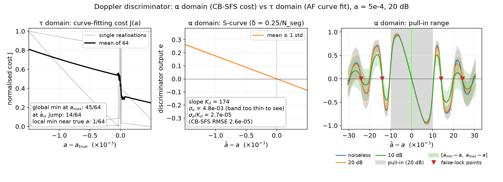

# OCDM Doppler estimation

Clean-room implementation (from scratch, per Ron's request) of the signal
model and estimators behind the AF-magnitude Doppler estimator for OCDM,
and a reproduction of the previous results (22-Jan and 31-Jan 2026
documents), as the baseline for the proposed closed-loop detector.

Sources:
- **[OCDM]** Z. Tan, *OCDM Signal Analysis* — signal model (Sec. 2–3),
  analytical AF (Eqns. 8–12), Section-4 algorithm.
- **[CBSFS]** M. Kumar and R. Dabora, *A Novel Sampling Frequency Offset
  Estimation Algorithm for OFDM Systems Based on Cyclostationary
  Properties*, IEEE Access 7, 2019 — Eqns. (27)–(34).
- *Algorithm Steps & Results*, 22-Jan and 31-Jan 2026 (the results
  documents, "the documents" below).

## Status

| step | what | state |
|---|---|---|
| 1 | infrastructure: signal model, analytical AF, CB-SFS | done |
| 2 | Section-4 curve-fitting estimator + reproduction of the documents' figures and tables | done (see *Step 2 results*) |
| 3 | early-late discriminator S-curve (proof of concept for the loop) | done (see *Step 3 results*) |
| 4 | proposal to Ron; his feedback: detector characteristic vs true a, Δ = {0} vs all lags, SNR working point, first-order loop | done (see *Step 4 results*) |
| 5 | tracking a time-varying Doppler a(t): ramp (choice of pole), sinusoid (frequency response), fly-by | done (see *Step 5 results*); built in new modules, existing ones unchanged |
| 6 | second-order tracking loop vs first-order loop | **paused** after Part A (implementation, verification) and Part B (constant a, acquisition); Parts C (ramp), D (fly-by), E (frequency response) and the robustness check pending (see *Step 6 results*) |
| 7 | other waveforms (OTFS) and multipath; detector bias explained (DC-line leakage) | done (see *Step 7 results*); new modules only |

## Layout

Package `ocdm_doppler/` (NumPy only):

| module | contents |
|---|---|
| `params.py` | `SystemParams` — one frozen object fully describes an experiment; presets mirror the two results documents |
| `signal_model.py` | OCDM transmitter `X(t)`, single-path Doppler receiver `Y(t)` ([OCDM] Eqn. 3), deterministic block noise |
| `analytical_af.py` | `Pi`, `Theta`, `Gamma`, `c_Y`, `af_magnitude` ([OCDM] Eqns. 8–12) |
| `cbsfs.py` | segmented CAF (27), autocorrelated CAF (28), cost function (29), peak location, Doppler estimate (33)–(34) |
| `af_estimation.py` | documents' Step 2(a)–(b): time selection (Eqn. 1), lag grid, empirical AF, window detection |
| `curve_fit.py` | documents' Step 3: `|A0|^2` and `tau_p0` estimates, MSE curve fit over `N_a` candidate Doppler values |
| `discriminator.py` | early-late discriminator on the CB-SFS cost (29): `predicted_alpha`, `early_late`, `s_curve`; `e > 0` means `a_hat` too small; default `delta = 0.25/N_seg` (selected in Step 3) |
| `loop.py` | first-order loop `a_hat += mu e` on consecutive blocks of one long received signal (`run_loop`; data symbols generated lazily, per-block noise, several SNRs in lockstep); `n95`, `steady_state_var`; constant `a` only |
| `doppler_profile.py` | Step 5: Doppler profiles a(t) with closed-form A(t) = ∫a and `block_mean`: `ConstantDoppler`, `RampDoppler`, `SinusoidalDoppler`, `FlyByDoppler`, `PiecewiseLinearDoppler` (any profile through points), `CallableDoppler` (user a(t) + closed-form A(t)), `as_profile` |
| `signal_tv.py` | Step 5: `rx_profile`, `rx_nominal_profile` — received signal for any profile (time warp t + A(t) − τ_p0, carrier phase 2π((f_Tx − f_Rx)t + f_Tx A(t))), reusing `OCDMSignal` internals; works for `OCDMSignal` and `loop.LongSignal`; a `ConstantDoppler` is delegated to `OCDMSignal.rx` (bit-identical to all old results) |
| `loop_tv.py` | Step 5: `run_loop_profile` — the loop of `loop.run_loop` for any profile (same signal, noise and update; several μ in lockstep), result with `a_bar`, `eps`; analytical `H`, `f_3db`, `ramp_lag`, `ramp_rmse`, `optimal_g`, `sine_rmse` |
| `loop_filters.py` | Step 6: loop filters `FirstOrderFilter` (â += μe), `SecondOrderFilter` (b̂ += μ2 e; â += b̂ + μ1 e), `make_filter`; design helpers (poles, (ζ, ω_n), critically damped, `design_equal_BL`), closed-loop `H2`, `f_3db`, exact `B_L` (discrete Lyapunov), `linear_response`, `step_response`, `n95`, `overshoot`, steady-state ramp / parabola errors, `closed_loop_poles` (with K_d/K_d0); `Design`, `first_order_design`, `equal_BL_design` |
| `wf_params.py` | Step 7: `WaveformParams` (SystemParams whose `N_sym` is the waveform's mean-power period `P_samp`), `detector_params`; passed only to the detector |
| `waveforms.py` | Step 7: `OCDMWaveform` (wraps `loop.LongSignal`), `OTFSWaveform(M, N, N_gi, guard)` with guard `"symbol"` or `"frame"` (unitary ISFFT, Heisenberg modulator, rectangular pulse, centred subcarriers); per-realisation lazy signals with `tx`, `P_samp`, `mean_power`, `autocorr`, `demod` |
| `channel.py` | Step 7: `MultipathChannel` / `Path` (gain, fractional delay, optional own Doppler profile), `single_path`, `exponential_pdp`, `received`, `rx_block` (OCDM single path delegated to the old code: bit-identical) |
| `channel_norm.py` | Step 7: exact mean received power incl. cross terms, `power_factor` G = P_ref/P_ch, `normalised_params` (A_p0 × √G) |
| `loop_wf.py` | Step 7: `run_loop_wf` (waveform + channel, harmonic k per filter), `open_loop_e` |
| `loop_wf2.py` | Step 7: `run_loop_det`, `open_loop_det` — as `loop_wf` with a cost function per filter (current and DC-removed detector in lockstep) |
| `cbsfs_dc.py` | Step 7: `cost_function_dc` — CB-SFS cost with the block mean of \|y\|² removed before the CAF (`remove_dc=False` = `cbsfs.cost_function` bit for bit) |
| `loop_tv2.py` | Step 6: `run_loop_filters` — the loop of `run_loop_profile` with filter objects (same signal, noise stream, detector call; all filters × SNRs in lockstep; `states` to continue a run exactly); `FirstOrderFilter` reproduces `run_loop_profile` bit for bit |

Scripts (run from this directory; need `matplotlib` for the figures):

| script | output |
|---|---|
| `verify_infrastructure.py` | 10 sanity checks (10/10 passing; check 6 = discriminator zero and sign) |
| `make_figures.py` | `figures/*.png` + `figures/figures_log.txt` — every figure of the documents, the curve-fitting cost surface, a [CBSFS] Fig. 5-style plot (~9 min; `--a-sr genie` skips CB-SFS) |
| `mc_curvefit.py` | `results/mc_curvefit.csv` / `.md` — Monte-Carlo NMSE and bias tables of the documents, ours next to theirs; incremental, `--resume` after an interruption |
| `mc_cbsfs_22jan.py` | Monte-Carlo NMSE of CB-SFS alone |
| `study_scurve.py` | Step 3: discriminator S-curves, metrics and the tau-domain contrast → `results/scurve.csv` / `.md` / `_log.txt`, raw costs in `results/scurve_raw/`, `figures/fig_scurve_*.png`; `--quick`, `--resume`, `--max-new` (~27 min compute, 4 processes), `--replot` (tables + figures from the raw data only, seconds) |
| `study_snr_definitions.py` | Step 4 A: SNR definitions, simulated SER, 10 % working point → `results/snr_definitions.*`, `figures/fig_ser_working_point.png` (~10 s) |
| `study_characteristic.py` | Step 4 B: open-loop detector characteristic vs true `a`, Δ = {0} vs {0..15} → `results/characteristic.*`, raw `results/char_raw/`, `figures/fig_char_*.png` (~20 min, 4 processes; `--quick`, `--resume`, `--max-new`, `--replot`) |
| `check_detector_offset.py` | Step 4: the a = 0 detector-offset check (256 fresh noiseless blocks, ~30 s) |
| `study_loop.py` | Step 4 C/D: `--part C` convergence times (~2 min); `--part D` closed loop vs SNR → `results/loop_sim.*`, raw `results/loop_raw/`, `figures/fig_loop_*.png` (~70 min, 8 processes; `--quick`, `--resume`, `--max-new`, `--max-real`, `--replot`) |
| `verify_time_varying.py` | Step 5 A.4: verification of the time-varying code → `results/verify_time_varying.md` (~4 min) |
| `study_tracking.py` | Step 5 B/C/D: `--part B` ramp (up and down) and optimal pole, `--part C` sinusoid / frequency response, `--part D` fly-by → `results/tracking_{ramp,sine,flyby}.*`, raw `results/track_raw/`, `figures/fig_track_*.png`; checkpointed segments (`--resume`, `--budget`, `--seg`, `--quick`, `--replot`) |
| `check_bias_phase.py` | Yogev's check of the detector bias vs the sampling phase (integer vs non-integer shift a·N_c per block) → `results/bias_phase_check.md` |
| `verify_second_order.py` | Step 6 A: verification of the loop filters → `results/verify_second_order.md` (~7 min) |
| `verify_step7.py` | Step 7 A: verification of the waveform / channel / runner layers → `results/verify_step7.md`, `figures/fig_wf_mean_power.png` (~1 min) |
| `study_otfs.py` | Step 7: `--part B` OCDM vs OTFS-symbol, `--part C` OTFS-frame vs harmonic k, `--part D` multipath and multiscale → `results/otfs_{B,C,D}.*`, raw `results/otfs_raw/`, `figures/fig_otfs_*.png`; `--quick`, `--resume`, `--replot`, `--budget`, `--procs` |
| `check_nseg_leakage.py` | Step 7: N_seg = 2048 vs 1920 (OTFS-frame, OCDM; paired on the same blocks) → `results/nseg_leakage.md` |
| `check_dc_removal.py` | Step 7: DC-removed vs current detector (paired) → `results/dc_removal.md` |
| `count_ops_lag0.py` | Yogev's explicit real-multiplication count of one Δ = {0} update, checked bit-exact against `discriminator.early_late`: 495,244 RM per update = 20.635 RM/sample |
| `study_second_order.py` | Step 6: `--part B` constant a and acquisition → `results/so_constant.md`, `so_steady.csv`, `so_acquisition.csv`, raw `results/so_raw/`, `figures/fig_so_*.png`; all realisations of all cases advance in checkpointed rounds (`--resume`, `--budget`, `--seg`, `--procs`, `--quick`, `--replot`); Parts C–E to be added |
| `study_cbsfs_accuracy.py` | CB-SFS sweeps over `M`, `N_seg`, harmonic index (tables below) |

## Design decisions worth knowing

**No resampling.** [OCDM] Eqn. (3) is a closed form for `Y(t)`, so the
receiver is evaluated directly at whatever instants an estimator asks for.
This avoids interpolation error entirely and is faster than generating a
long oversampled waveform.

**The guard interval is a zero gap, not a cyclic prefix.** In [OCDM]
`g(t) = 1` only on `[0, T_is)`, so each OCDM symbol is followed by `T_gi`
of silence. This is what makes `|Y[k]|^2` periodic and gives CB-SFS its
strongest cyclostationary signature.

**Two distinct sampling grids.** AF estimation uses the fine grid `T_s`
(the CT approximation); CB-SFS uses the receiver's nominal rate
`T_samp_ns`. These are kept separate on purpose — quantising the nominal
samples onto the `T_s` grid introduces a spurious rate error of order
`1/rho ≈ 1e-3`, i.e. the same size as the Doppler being measured.

**`cost_function` takes arbitrary cycle frequencies.** Not just a uniform
grid. The planned early-late discriminator evaluates the cost at two
`alpha` values either side of the predicted harmonic, so it can call this
directly and nothing in `cbsfs.py` needs to change.

**Time origin at received symbol K.** The documents average over
`i = -(N_avg-1)/2 .. +(N_avg-1)/2` around `t' = 0`, i.e. they assume the
signal exists at negative times. `af_estimation.make_signal` places the
receiver's time origin at the start of received symbol `K > (N_avg-1)/2`
(`t_origin = K T_sym / (1+a)`), which shifts `(1+a)t - tau_p0` by exactly
`K T_sym`: the within-symbol position, `Gamma` and `|Pi|` are unchanged.
The analytical AF for a *candidate* `a` must be evaluated at the receiver
time `t_sel`, not at `t_origin + t_sel` — the origin shift is exact only
for the true `a` (`WindowedAF.analytical` does this).

**CB-SFS settings for `a_sr`** (not stated in the documents): `N_c = 24000`
samples, `N_seg = 2048`, harmonic 1, window `±0.05 alpha_1` with 128 points,
parabolic refinement. Figures and Monte-Carlo use the same settings.

## Step 2 results: the curve-fitting estimator

The estimator follows the documents exactly (Steps 1–3): `a_sr` from
CB-SFS; `t_sel` by the variance test; `N_lag` lags, window of highest power;
`|A0|^2_hat = 4 sigma_hat^2_Y(t_sel) / sigma_D^2`,
`tau_p0_hat = (t_sel - tau_win_r)(1 + a_sr)`; `N_a = 2^18` candidates in
`(a_min, a_max)`, minimum MSE between the windowed empirical AF and
`|Pi * Gamma|`.

**Monte-Carlo NMSE, 128 trials** (`results/mc_curvefit.md` has the full
tables incl. normalised bias). **Ours** / documents:

| case | SNR (dB) | CB-SFS | `|A0|^2` | `tau_p0` | **Doppler (curve fit)** |
|---|---|---|---|---|---|
| 31-Jan (noiseless, `a_sr = a`) | ∞ | – | – | – | **4.24** / 4.91 (bias −0.84 / −1.01) |
| S1 | 10 | 0.0081 / 0.065 | 0.099 / 0.095 | 0.21 / 0.99 | **0.78** / 1.17 |
| S1 | 20 | 0.0030 / 0.0044 | 0.0020 / 0.0018 | 0.082 / 0.030 | **1.00** / 1.49 |
| S2 (`rho = 2^6`) | 10 | 0.0069 / 0.065 | 0.097 / 0.099 | 0.37 / 1.69 | **0.81** / 1.33 |
| S2 | 20 | 0.0029 / 0.0044 | 0.0020 / 0.0020 | 0.079 / 0.031 | **0.99** / 1.64 |
| S3 (`a_max = 1e-2`) | 10 | 6.4e-5 / 6.5e-4 | 0.097 / 0.098 | 0.38 / 1.85 | **0.84** / 0.60 |
| S3 | 20 | 3.0e-5 / 4.4e-5 | 0.0021 / 0.0018 | 0.036 / 0.033 | **0.27** / 0.57 |
| S4 (`a_max = 1e-2`, `rho = 2^6`) | 10 | 8.6e-5 / 6.5e-4 | 0.099 / 0.098 | 0.23 / 1.51 | **0.89** / 0.58 |
| S4 | 20 | 3.3e-5 / 4.4e-5 | 0.0020 / 0.0019 | 0.034 / 0.105 | **0.29** / 0.49 |
| S5 (`N_is = 64`) | 10 | not run — see *What is missing* | | | |
| S5 | 20 | not run — see *What is missing* | | | |
| dense window (`N_lag = 2^8` in the known window) | 20 | 0.0030 / 0.0071 | 0.0020 / 0.0019 | 7.5e-10 / 9.7e-4 | **2.21** / 4.77 |

The documents' 4096-trial bias run (S1, 20 dB) was not repeated (see
*What is missing*); the 128-trial biases are in `results/mc_curvefit.md`
(S1, 20 dB: Doppler +0.63 vs the documents' +0.67).

**The documents' conclusion is reproduced: the curve-fitting Doppler
estimate is essentially uninformative** (NMSE 0.3–4, vs 1e-2 – 1e-5 for
the CB-SFS estimate it starts from), and a denser lag grid makes it worse.

### Why — three mechanisms

**1. The cost surface is flat and monotone, so the estimate goes to a grid
boundary.** `|Pi|` stretches by `(1+a)`, i.e. the lag axis of the analytical
curve changes by only 0.2 % across the whole range `(a_min, a_max)`
(`1 ± 1e-3`) — comparable to or below the residual
model mismatch of the empirical AF (0.6 % of the peak even noiseless,
finite `N_avg`). The MSE is therefore dominated by that mismatch and is
nearly flat and monotone in `a` (`figures/fig_curvefit_cost.png`: it varies
by ~1–2 % over the range in the noisy runs, ~20 % noiseless, with no
minimum near the true `a`). The sign of the mismatch decides which end
wins: in the 31-Jan run 107 of 128 estimates sit exactly at `a_min` (49)
or `a_max` (58), which is what the documents' numbers imply too (half at
each end gives NMSE = 0.5·3² + 0.5·1² = 5, bias −1). In the 22-Jan runs
most estimates sit at `a_max` (87–107 of 128 for S1–S4, except S3/S4 at
20 dB — see 2).

**2. The window-edge `tau_p0` estimate ties the fit to `a_sr`.** With
`tau_p0_hat = (t_sel - tau_win_r)(1 + a_sr)`, the analytical `Gamma` for the
candidate `a = a_sr` has its upper edge exactly on the last windowed lag:
candidates below `a_sr` drop that lag (`Gamma = 0`), candidates above keep
it. The cost therefore has a jump at `a_sr`, and the minimum is either
there or at a boundary. Where it lands at `a_sr`, the "curve-fit" estimate
is really the CB-SFS estimate — this is why S3/S4 at 20 dB look better
(NMSE ≈ 0.28; only 12–14 of 128 at `a_max`): not information from the AF.

**3. `|A0|^2_hat` carries the noise power.** `sigma_hat^2_Y` includes `P_n`,
so `|A0|^2_hat` is biased by `4 P_n / sigma_D^2` (relative `+0.31` at 10 dB,
`+0.031` at 20 dB) — NMSE 0.098 / 0.0020, matching the documents to ~10 %
in every setting. This scales the analytical curve and adds to the
mismatch in (1).

**Denser lags make it worse** (dense window: Doppler NMSE 2.2 vs 1.0):
`tau_p0` becomes essentially exact, but the additional lags are mostly in
the sidelobes, where the empirical AF has a noise floor
`≈ sigma_D^2 |A0|^2 / (4 sqrt(N_avg))` and the analytical AF has nulls —
more weight on the part of the curve that carries no Doppler information
and the most mismatch (documents p. 3 figure; `fig_22jan_dense_window.png`).

**Where our numbers differ from the documents:** CB-SFS is 1.5–10× more
accurate here (their CB-SFS parameters are not stated; `N_seg` alone moves
the error by orders of magnitude, see below), and at 10 dB our `tau_p0`
NMSE is lower (0.2–0.4 vs 1.0–1.8). The Doppler conclusions do not depend
on either.

### What is missing, and why

Everything in the documents has been reproduced except the following:

| item | status | why | how to complete |
|---|---|---|---|
| **Monte-Carlo, Setting 5** (`N_is = 64`), 10 and 20 dB | **not run** | Four background runs launched from Claude Code were killed by its idle-session low-memory safeguard (the system as a whole ran low on memory; the script uses ~300 MB per process). S5 is ~4× slower per trial than S1–S4 (CB-SFS has 64 lags instead of 16), so one 128-trial S5 case takes ~20–30 min and never finished before a kill. Results are saved per completed case, so nothing else was lost. | `python mc_curvefit.py --resume --cases 22jan --settings 5 --procs 1` in a normal terminal (~40–60 min); it appends to `results/mc_curvefit.csv` and rebuilds the `.md`. |
| **Normalised-bias run, N_mc = 2^12** (S1, 20 dB; documents p. 3) | **skipped (decision)** | ~2.5 h of compute, too long to survive the memory kills above. Our 128-trial biases are already in `results/mc_curvefit.md` and are close to the documents' 4096-trial values for S1, 20 dB (Doppler +0.63 vs +0.67, `|A0|^2` +0.032 vs +0.031; `tau_p0` +0.099 vs +0.093; CB-SFS +0.0032 vs +0.0012). | `python mc_curvefit.py --resume --cases bias` (~2.5 h). |

What *is* available for Setting 5: the single-realisation figure
`figures/fig_22jan_setting5.png` (it matches the documents' broken case:
analytical AF flat at ~0.005, empirical AF noise) and its curve-fit numbers
in `figures/figures_log.txt` (`a_hat_mag` at `a_min` at both SNRs; at
20 dB `tau_p0_hat` = 1.49e-6 vs 0.5e-6 true). A 2-trial smoke test gave
Doppler NMSE 9 and `tau_p0` NMSE 7.8 at 20 dB (documents: 8.48, 19.9) —
consistent with the documents but far too few trials to report.

Not started yet (by plan): Steps 4–5 (proposal to Ron, closed-loop
detector).

## Step 3 results: the early-late discriminator (proof of concept)

**Question.** Does a discriminator in the cycle-frequency domain have what a
tracking loop needs — a zero crossing at the true Doppler, a linear region
with a usable slope, a wide pull-in range, a measurable noise level — where
the curve-fitting cost (Step 2) has none of these? This is evidence for the
*loop proposal*, not a claim that a loop is more accurate than CB-SFS.

**Discriminator** (`ocdm_doppler/discriminator.py`). Predict the harmonic at
`alpha_p = (1 + a_hat) / N_sym` (k = 1), evaluate the CB-SFS cost (29) at
`alpha_p ± delta`, and output `e = (C+ − C−) / (C+ + C−)`. `e > 0` means
`a_hat` is too small, so the loop update is `a_hat += mu e`. Two cost
evaluations per update, versus a grid of 128–512 for CB-SFS.

**Setup** (`study_scurve.py`): 22-Jan preset, N_c = 24000, N_seg = 2048,
harmonic 1; `a_hat − a` over ±3e-2 (dense ±2e-3); `delta` ∈ {0.25, 0.5,
0.75}/N_seg. N_mc = 64 for a = 5e-4 (the main results). The a = 5e-3 runs
use N_mc = 16 and **only check that the S-curve depends on the offset
alone**, not on a. The mean S-curves coincide (`figures/fig_scurve_snr.png`,
right): same K_d (175 vs 174), same pull-in, same stable points. σ_e/K_d
comes out 12–25 % lower at a = 5e-3; with 16 trials a standard deviation is
itself uncertain by ≈ 18 %, so this is at the edge of what the check
resolves (the ratio to CB-SFS on the same data is ≈ 1.0 at both a).
Full tables: `results/scurve.md`.



**Choice of delta.** Fixed before the run: the smallest σ_e/K_d at a = 5e-4,
20 dB, among the deltas whose pull-in range covers `[a_min − a, a_max − a]`.
All three qualify; **δ = 0.25/N_seg** has the best accuracy. Larger δ gives
a steeper slope and a wider pull-in, but the probe points sit lower on the
main lobe where the cost is smaller and relatively noisier, so the noise
grows faster than the slope (`figures/fig_scurve_delta.png`):

| δ·N_seg (a = 5e-4, 20 dB) | K_d | pull-in (≥ 90 % correct sign) | σ_e/K_d |
|---|---|---|---|
| 0.25 | 174 | ±9.9e-3 | **2.7e-5** |
| 0.5 | 369 | ±1.3e-2 | 3.7e-5 |
| 0.75 | 584 | ±1.5e-2 | 1.0e-4 |

**Characteristics at δ = 0.25/N_seg, a = 5e-4, N_mc = 64:**

| SNR | bias (zero crossing) | K_d | linear (R², ±2e-3) | pull-in | σ_e at 0 | **σ_e / K_d** | CB-SFS RMSE, same data | CB-SFS RMSE, Step 2 (128 trials) |
|---|---|---|---|---|---|---|---|---|
| noiseless | +2.6e-6 | 174 | 1.0000 | ±9.9e-3 | 4.4e-3 | **2.5e-5** | 2.4e-5 | – |
| 20 dB | +1.9e-6 | 174 | 1.0000 | ±9.9e-3 | 4.8e-3 | **2.7e-5** | 2.6e-5 | 2.7e-5 |
| 10 dB | +1.5e-6 | 174 | 1.0000 | ±9.9e-3 | 7.9e-3 | **4.6e-5** | 4.3e-5 | 4.5e-5 |

- **Zero crossing at the true Doppler.** The bias (≤ 2.6e-6, < 0.6 % of a) is
  below its own standard error σ_e/(K_d √64) ≈ 3–6e-6: no measurable bias.
- **Linear with a constant slope.** K_d = 174 at every SNR (175 at
  a = 5e-3); the mean S-curve is linear to R² = 1.0000 over ±2e-3, i.e. the
  whole `a_min..a_max` scale.
- **Wide pull-in.** ±9.9e-3 (grid step 7.6e-4 there), i.e. 10× the prior
  range `|a| < 1e-3`, as
  predicted by the main-lobe nulls at ±1/N_seg in α ⇒ ±N_sym/N_seg = ±9.8e-3
  in a.
- **The implied single-block error σ_e/K_d equals the CB-SFS RMSE** on the
  same data (ratio 1.01–1.06) and the Step-2 CB-SFS RMSE — same order, as
  expected: both read the same peak of the same cost function. The noise
  floor at high SNR (noiseless σ_e ≈ 20 dB σ_e) is the self-noise of the
  cyclostationary estimate from a finite record with random data, not
  channel noise.

**False locks.** Beyond the pull-in range the S-curve follows the Dirichlet
sidelobes of the cost function, and a loop (which climbs `C`) can settle on
a sidelobe peak. The mean S-curve has stable zero crossings at
**±1.41e-2 and ±2.41e-2** (every SNR), matching the sidelobe peaks at
±1.5/N_seg and ±2.5/N_seg in α (±1.46e-2, ±2.44e-2 in a). With the prior
`|a| < 1e-3` (22-Jan S1/S2) any initialisation in `[a_min, a_max]` is well
inside the pull-in range. For `a_max = 1e-2` (S3/S4) the prior range is as
wide as the pull-in range, so the loop should be initialised from a CB-SFS
acquisition (or acquire with a smaller N_seg: the pull-in scales as
`N_sym / N_seg`).

**Contrast with the τ domain** (same 64 realisations, a = 5e-4, 20 dB;
`figures/fig_scurve_tau.png`). The curve-fitting cost J(a) (Step 2, N_a =
2^12) has its global minimum at `a_max` in 45, at the `a_sr` window-edge
jump in 14, at `a_min` in 1 and in the interior in 4 of 64 realisations.
Its gradient discriminator `e_tau = −dJ/da` is positive almost everywhere
(J decreases towards `a_max`): only 4 of 64 realisations have any zero
crossing (a local minimum of J) away from the ends and the jump, and only
**1 of 64** has one within 1e-4 of the true a. A gradient-following loop on
the AF-magnitude fit would drift to `a_max`. RMSE of `argmin J`: 4.9e-4,
versus 2.6e-5 for the CB-SFS `a_sr` it starts from.

**What this does *not* show.** No steady-state accuracy advantage over
CB-SFS: on the same block, one discriminator update is exactly as accurate
as the CB-SFS grid search (σ_e/K_d ≈ CB-SFS RMSE), and averaging a loop over
L blocks is equivalent to CB-SFS on an L-times longer record. The loop's
advantages are elsewhere: **tracking a time-varying Doppler** (CB-SFS would
be re-run from scratch on every block) and **cost per update** — 2 cost
evaluations instead of a 128–512-point grid.

**What a loop simulation would add (Step 5, after Ron's feedback, not done
here):** iterate `a_hat_{n+1} = a_hat_n + mu e_n` over consecutive blocks
and measure the convergence time and steady-state jitter versus `mu` (loop
noise bandwidth), the tracking lag for a Doppler ramp, and the
false-lock / cycle-slip probability versus the initial error.

## Step 4 results: detector characteristic and first-order loop

Advisor feedback after Step 3 (task file `tasks/step4_detector_and_loop.md`):
plot the detector characteristic against the **true** a; bias and NMSE vs
SNR for several Doppler values; compare Δ = {0} with all lags; work at a low
SNR (≈ 10 % symbol errors); compute and simulate a first-order loop
(pole 0.99). All runs: 22-Jan preset (BPSK), N_c = 24000, N_seg = 2048,
k = 1, δ = 0.25/N_seg, seeds 1000 + index.

### A. SNR definitions and the working point (`results/snr_definitions.md`)

| definition | in terms of σ_D²/P_n | offset |
|---|---|---|
| per received sample, active part | \|A0\|²/4 · σ_D²/P_n | −4.89 dB |
| per received sample, average over symbol + GI | \|A0\|²/4 · N_is/N_sym · σ_D²/P_n | −5.86 dB |
| per data symbol after DFnT, Es/N0 (= Eb/N0 for BPSK) | \|A0\|²/4 · σ_D²/P_n | −4.89 dB |

The hand calculation is confirmed (front-end factor h = A_p0 e^{−j2πf_Tx τ_p0}/2,
unitary DFnT, E|n|² = P_n). Simulated with a = 0, perfect timing, CFO
removed, 64 000 symbols per point: SER = 10 % at **σ_D²/P_n = 4.01 dB for
BPSK** (theory 4.04 dB, Es/N0 = −0.86 dB) and 9.15 dB for QPSK (theory
9.15 dB). **Working point (WP) used below: σ_D²/P_n = 4.0 dB** (BPSK). The
SNR grid of B and D runs from −5 to 20 dB plus noiseless, so the mapping to
another definition (Q2) only shifts the axis by the offsets above.

### B. Open-loop detector characteristic (`results/characteristic.md`)

â = 0 fixed, true a swept (41 points over |a| ≤ 1e-3, 1e-3 steps to ±2e-2),
64 blocks per (a, SNR), both lag sets on the same blocks.
`figures/fig_char_detector.png` (mean e/K_d0 vs a with the line y = x),
`fig_char_bias.png`, `fig_char_kd_vs_snr.png`.

| σ_D²/P_n | K_d/K_d0, {0} | K_d/K_d0, {0..15} | σ_e/K_d, {0} | σ_e/K_d, {0..15} | ratio |
|---|---|---|---|---|---|
| ∞ | 1.000 | 1.000 | 1.60e-5 | 2.43e-5 | 1.5 |
| 20 dB | 1.000 | 1.000 | 1.59e-5 | 2.56e-5 | 1.6 |
| 10 dB | 1.000 | 1.002 | 2.01e-5 | 4.38e-5 | 2.2 |
| 5 dB | 1.001 | 1.002 | 3.72e-5 | 1.13e-4 | 3.0 |
| **4 dB (WP)** | **1.000** | **1.000** | **4.59e-5** | **1.47e-4** | **3.2** |
| 2.5 dB | 0.999 | 0.995 | 6.68e-5 | 2.31e-4 | 3.5 |
| 0 dB | 0.994 | 0.957 | 1.47e-4 | 5.84e-4 | 4.0 |
| −5 dB | **0.549** | **0.127** | 1.92e-3 | 1.48e-2 | 7.7 |

K_d0 = 175.5 for both lag sets (noiseless).

- **Linear and unbiased over the prior range** for both lag sets down to
  0 dB: R² ≥ 0.993, zero crossing within one standard error of 0, max
  |bias| 1.9–2.9 standard errors over the 40 points (consistent with
  noise; the points share data). Pull-in ±1e-2 (main-lobe nulls), as in Step 3.
- **K_d is constant with SNR down to ≈ 0 dB** (Δ = {0}: −0.6 % at 0 dB;
  {0..15}: −4 %). At −5 dB the gain drops to 0.55 K_d0 ({0}) and
  collapses to 0.13 K_d0 ({0..15}, R² = 0.24): below 0 dB a loop designed
  with K_d0 is slower than designed (and {0..15} essentially stops working).
- **Δ = {0} is better than {0..15} at every SNR** — same gain, 1.5× lower
  single-block error noiseless and 3.2× lower at the WP — and costs
  **20.6 RM/sample** instead of 300 (|Y|² is real; with lag 0 counted as
  complex the Step-3 convention gives 26.6 and 306).
- **Unexpected: an offset at a = 0 exactly** (+1.1e-5, 11 σ in a separate
  check with 256 fresh blocks, both δ = 0.25 and 0.5 /N_seg:
  `python check_detector_offset.py`). It is absent at a = 2.5e-4, 5e-4,
  1e-3 (≤ 1.5 σ), and in the Part B data only the a = 0 point is offset
  (`python study_characteristic.py --near-zero`). At a = 0 the receiver samples
  synchronously (N_sym = 20 samples per symbol), so the sampled signal is
  exactly cyclostationary and the guard-interval zeros fall on the same
  sample positions in every symbol. The mechanism is not yet understood;
  the table excludes a = 0 from K_d, the zero crossing and max |bias| and
  reports it separately. The loop runs below avoid a = 0.

### C. Convergence time (`results/loop_convergence.md`, `figures/fig_loop_step.png`)

n95 = ln(0.05)/ln(p) blocks, μ = (1 − p)/K_d(N_c). K_d does not depend on
the block length (175.4 / 175.5 / 175.3 for N_c = 24000 / 12000 / 6000).

| pole p | n95 (blocks) | N_c = 24000 (6 ms) | N_c = 12000 | N_c = 6000 | simulated n95 (24000 / 12000 / 6000) |
|---|---|---|---|---|---|
| 0.9 | 28.4 | 0.17 s | 0.085 s | 0.043 s | 29 / 30 / 23 |
| 0.95 | 58.4 | 0.35 s | 0.18 s | 0.088 s | 57 / 57 / 52 |
| 0.99 | 298.1 | **1.79 s** | 0.89 s | 0.45 s | 293 / 288 / 242 |

The noiseless step response follows 1 − pⁿ for N_c = 24000 and 12000.
For N_c = 6000 (only 1.46 × 2N_seg; the autocorrelated CAF then uses 32 %
of the samples) the loop settles **3.8 % above** a (bias +1.9e-5 at
a = 5e-4, p = 0.99), which is why it "converges" early; the same bias is
+1.0 % at N_c = 12000 and +0.3 % at N_c = 24000. N_c = 6000 is too short.

### D. Closed loop vs SNR (`results/loop_sim.md`)

Δ = {0}, pole 0.99 (μ = 0.01/K_d0), â_0 = 0, a ∈ {±1e-4, ±5e-4, ±1e-3},
9 SNRs; 8 realisations × 2000 steady-state blocks after discarding 1633
blocks (3 n95 at the slowest SNR, −5 dB, where g_eff = 0.0055). The loop
output is correlated over ≈ 1/g = 100 blocks: N_eff ≈ 130–220 for the
variance and 66–111 for the mean per (a, SNR).

At the working point (4 dB):

| a | bias | norm. bias | NMSE | NMSE pred. (var only) | RMSE |
|---|---|---|---|---|---|
| −1e-3 | −2.3e-6 ± 0.4e-6 | +0.002 | 1.8e-5 | 1.1e-5 | 4.2e-6 |
| −5e-4 | −4.2e-6 ± 0.3e-6 | +0.008 | 1.1e-4 | 4.2e-5 | 5.2e-6 |
| −1e-4 | −1.6e-6 ± 0.4e-6 | +0.016 | 1.4e-3 | 1.1e-3 | 3.7e-6 |
| +1e-4 | −1.9e-6 ± 0.4e-6 | −0.019 | 1.5e-3 | 1.1e-3 | 3.9e-6 |
| +5e-4 | +1.0e-6 ± 0.3e-6 | +0.002 | 4.7e-5 | 4.2e-5 | 3.4e-6 |
| +1e-3 | +1.6e-6 ± 0.6e-6 | +0.002 | 1.4e-5 | 1.1e-5 | 3.8e-6 |

Figures: `fig_loop_nmse_vs_snr.png` (CB-SFS Fig. 7 analogue),
`fig_loop_bias_vs_snr.png`, `fig_loop_vs_a.png` (mean â vs a against the
unbiased line, and NMSE vs a: the Rotem–Dabora Fig. 7 / CB-SFS Fig. 6
analogues; this is also the closed-loop version of the characteristic,
Q1), `fig_loop_trajectories.png`.

- **The linear prediction holds:** measured variance / predicted
  (σ_e/K_d)² g/(2 − g) = 0.84–1.35 over all a and SNR, 0.97–1.18 at the WP.
  At ≥ 10 dB it is 0.95–1.35: the in-loop σ_e is 3–11 % above Part B's,
  which was measured at a = 0 — the synchronous point above.
- **Steady-state RMSE ≈ 3.4–5.2e-6 at the WP**, i.e. about 10× below the
  single-block error σ_e/K_d = 4.6e-5: the loop averages over
  ≈ (2 − g)/g = 199 blocks (1.2 s of signal). This is integration, not a
  better estimator: CB-SFS averaged over the same 1.2 s would do the same.
- **Bias: small but resolved.** |bias| ≤ 4.2e-6 at the WP (≤ 2 % of a for
  |a| = 1e-4, ≤ 0.8 % for |a| ≥ 5e-4), statistically significant
  (standard errors 0.3–0.6e-6). It does not follow a simple pattern: at
  high SNR â mostly overestimates |a|, by 0.1–0.6 % (a = +1e-4: −0.1 %),
  and towards 0 dB the bias moves negative by 3–8e-6 for five of the six
  values of a (a = +1e-3: +2e-6).
  For |a| = 5e-4 at high SNR the bias dominates the NMSE (e.g. a = −5e-4,
  20 dB: NMSE 2.6e-5 vs 5.1e-6 predicted from the variance).
- **−5 dB:** NMSE ≈ 1 for |a| = 1e-4 (RMSE ≈ 1e-4 = a) — the loop still
  tracks but the estimate is no better than the prior; for |a| = 1e-3 the
  NMSE is 1e-2.

**Δ = {0..15} in the loop (reduced run, D.7:** a ∈ {1e-4, 1e-3}, 20 dB /
WP / 0 dB, 4 realisations × 1000 blocks, `fig_loop_lagsets.png`). NMSE at
the WP: 1.0e-2 vs 1.5e-3 (a = 1e-4) and 1.05e-4 vs 1.4e-5 (a = 1e-3) — **7×
worse than Δ = {0}**, in line with the open-loop variance ratio
(3.2² ≈ 10; the D.7 variance estimate has only ≈ 60 effective samples).
At 20 dB ≈ 2×, at 0 dB 10–16×. **Recommendation: Δ = {0}.**

**Not yet done / open:**
- **Q1, Q2** (advisor): the open-loop characteristic (B) and the
  closed-loop one (`fig_loop_vs_a.png`) are both available; the SNR mapping
  is in A.
- **Tracking a time-varying Doppler** (the case for a loop): done in
  Step 5, in new modules (`doppler_profile.py`, `signal_tv.py`,
  `loop_tv.py`) without changing `signal_model.py`; `loop.run_loop`
  points to `loop_tv.run_loop_profile` for a non-constant a.
- The small closed-loop bias (and the a = 0 offset) are not explained yet.

## Step 5 results: tracking a time-varying Doppler

Task file `tasks/step5_time_varying_doppler.md`. Settings as Step 4:
22-Jan preset (BPSK), Δ = {0}, N_c = 24000 (block 6 ms), N_seg = 2048,
δ = 0.25/N_seg, K_d0 = 175.5, μ = (1 − p)/K_d0; noiseless and the working
point σ_D²/P_n = 4.0 dB (σ_e/K_d = 1.60e-5 noiseless, 4.59e-5 at the WP);
|a| ≤ 1e-3 throughout.

**Rule: add, do not change.** A time-varying a(t) enters only through
A(t) = ∫a: time warp u = t + A(t) − τ_p0, carrier phase
2π((f_Tx − f_Rx)t + f_Tx A(t)). This is implemented in three new modules
that reuse the existing classes; the Step 1–4 modules are untouched
(allowed edits only: `__init__.py` exports, the text of `loop.run_loop`'s
`NotImplementedError`).

### A. Verification (`results/verify_time_varying.md`, all passing)

| check | result |
|---|---|
| `rx_profile(ConstantDoppler)` vs `OCDMSignal.rx`, noisy (≤ 1 s) and noiseless (≤ 120 s) | **0** (delegated, bit-identical) |
| general formula with a constant profile vs `rx`, against a 50-digit reference, t ≤ 120 s | carrier phase error **old 9.0e-5 rad, new 9.8e-8 rad**; time warp 1.3e-14 s vs 7.4e-15 s. The old/new difference (up to 1.4e-4 in Y) is the old formula's float rounding of (1+a)·f_Tx. |
| `run_loop_profile(ConstantDoppler)` vs `run_loop`; lockstep vs separate μ | **0** (bit-for-bit) |
| A(t) closed form vs Gauss–Legendre, 8 profiles, t ≤ 120 s | ≤ **5.6e-17 s** (3.5e-7 rad carrier phase; required ~1e-13 s) |
| record in one piece vs block by block; loop in segments vs one run | **0** |
| committed Step 4 raw data recomputed (Part B e, Part D trajectory) | **0** (bit-identical) |
| in-block Doppler change, β = 3.25e-7 per block: paired ramp − staircase (same block means) | **−3.1e-9 ± 3.8e-9** (1 % of β): no in-block bias |

### B. Ramp and the choice of pole (`results/tracking_ramp.md`)

β = r·g·σ_ss per block with g = 0.01, σ_ss = 3.25e-6, r ∈ {0.1, 1, 10}
(β = 3.25e-9 / 3.25e-8 / 3.25e-7 per block = 5.4e-7 / 5.4e-6 / 5.4e-5 /s);
poles {0.9, 0.95, 0.98, 0.99, 0.995}, plus 0.998 for r = 0.1, 1. Every ramp
is run **up and down over the same a interval**, so
(ε_up − ε_down)/2 is the lag free of any a-dependent detector bias and
(ε_up + ε_down)/2 the bias. 8 realisations × 3000 blocks (2500 for r = 10,
to keep |a| ≤ 1e-3 in both directions) after 3·n95 of the slowest pole.
`figures/fig_track_lag.png`, `fig_track_rmse_vs_pole.png`.

- **The lag is −β/g**, e.g. r = 10: −3.23e-6 / −6.47e-6 / −3.24e-5 /
  −6.49e-5 for p = 0.9 / 0.95 / 0.99 / 0.995 (predicted −3.25e-6 /
  −6.51e-6 / −3.25e-5 / −6.51e-5, noiseless); r = 1, p = 0.99: −3.36e-6 ±
  0.08e-6 (noiseless), −3.58e-6 ± 0.18e-6 (WP) vs −3.25e-6. With the up/down
  design even the r = 0.1 lag is resolved (noiseless, p ≥ 0.98: e.g.
  p = 0.998: −1.65e-6 ± 0.07e-6 vs −1.63e-6); a single direction alone
  would be dominated by the detector bias.
- **The bias** (ε_up + ε_down)/2 is the same for every pole (a detector
  property): ≈ −3e-7 noiseless and −1.1 to −1.6e-6 at the WP.
- **Std and RMSE** follow (σ_e/K_d)√(g/(2−g)) and √((β/g)² +
  (σ_e/K_d)²g/(2−g)) within ~10 %; for r = 10 the noiseless std is 20–70 %
  higher, because its measurement interval spans a ∈ ±4e-4 and the
  a-dependent bias shows up as extra variance.

**Optimal pole** (simulated: lowest **bias-removed** RMSE on the grid; the
per-direction RMSE gives the same choice):

| r | β per block | analytical p_opt, noiseless / WP | simulated (grid), noiseless / WP | min. RMSE at the WP |
|---|---|---|---|---|
| 0.1 | 3.25e-9 | 0.9945 / 0.9973 | 0.995 / 0.998 | 2.2e-6 |
| 1 | 3.25e-8 | 0.9747 / 0.9874 | 0.98 / 0.99 | 4.9e-6 |
| 10 | 3.25e-7 | 0.8863 / 0.9425 | 0.9 / 0.95 | 1.03e-5 |

In all six cases the simulated optimum is the grid point the analytical
curve selects.

### C. Sinusoid: frequency response (`results/tracking_sine.md`)

a(t) = 5e-4 sin(2πft), f = x·f_3dB(p), x ∈ {0.1, 0.3, 1, 3}, poles
0.9 (f_3dB = 2.797 Hz) and 0.99 (0.2666 Hz), both poles on every profile
(so each pole also gets the other's frequencies); 4 realisations, ≥ 3
periods after the transient (the longest run: 118 s).
`figures/fig_track_sine_response.png`, `fig_track_sine_example.png`.

**The loop follows H(z) = g z⁻¹/(1 − p z⁻¹) at every point**, noiseless and
at the WP: e.g. at f_3dB, p = 0.99: gain 0.7072 / 0.7076 (noiseless / WP)
vs 0.7071, phase −45.2° vs −45.3°; p = 0.9: 0.7056 / 0.7044 vs 0.7071,
−48.0° vs −48.1°; at 31.5 f_3dB (p = 0.99): 0.0322 vs 0.0319. Gain errors
≤ 0.9 % noiseless and ≤ 1.3 % at the WP (largest where the gain is only
0.03), phase within 1°; the tracking RMSE matches
√(amp²|1 − H|²/2 + (σ_e/K_d)²g/(2 − g)) within 0–8 %.

### D. Fly-by (`results/tracking_flyby.md`)

a(t) = −5e-4 (t − t0)/√((t − t0)² + T_c²) with peak slope per block equal
to β(r = 10) (T_c = 9.22 s, 73.8 s run) and β(r = 100) (T_c = 0.922 s,
7.4 s run); poles {0.9, 0.95, 0.99}, Part B's analytical WP optimum for
r = 10 (0.9425; the simulated optimum 0.95 is already in the set) and, for
r = 100, its own analytical optimum (0.7512); â_0 = a(0), 4 realisations.
`figures/fig_track_flyby_r10.png`, `fig_track_flyby_r100.png`.

| r | p | peak error (smoothed mean), noiseless | linear-model prediction | quasi-static β/g | RMSE at the WP (pred.) |
|---|---|---|---|---|---|
| 10 | 0.9 | 7.0e-6 | 3.25e-6 | 3.25e-6 | 1.10e-5 (1.06e-5) |
| 10 | 0.95 | 9.5e-6 | 6.5e-6 | 6.5e-6 | **7.85e-6** (7.76e-6) |
| 10 | 0.99 | 3.29e-5 | 3.23e-5 | 3.25e-5 | 1.20e-5 (1.29e-5) |
| 100 | 0.9 | 4.1e-5 | 3.2e-5 | 3.25e-5 | **1.61e-5** (1.63e-5) |
| 100 | 0.95 | 7.0e-5 | 6.4e-5 | 6.5e-5 | 2.54e-5 (2.59e-5) |
| 100 | 0.99 | **2.55e-4** | 2.54e-4 | 3.25e-4 | 1.11e-4 (1.12e-4) |
| 100 | 0.7512 | 2.5e-5 | 1.3e-5 | 1.3e-5 | 1.83e-5 (1.80e-5) |

- **The RMSE over the run matches the exact linear model** (a_bar through
  â ← â + g(a_bar − â)) within 8 % for every pole, noiseless and at the
  WP. The loop never loses lock (largest error 2.6e-4, far inside the
  ±1e-2 pull-in range).
- **The quasi-static rule ε ≈ −β(t)/g holds when the loop memory 1/g is
  short compared with T_c**; for p = 0.99 at r = 100 (memory 100 blocks vs
  T_c = 154 blocks) it overstates the peak (3.25e-4 vs 2.55e-4 measured,
  which the linear model predicts).
- **Best pole by RMSE at the WP:** r = 10: 0.95 (7.85e-6), close to Part B's
  ramp optimum (0.9425–0.95). r = 100: 0.9 (1.61e-5), *slower* than the
  ramp optimum for its peak slope (0.75, 1.83e-5) — as the linear model
  also predicts, because the fly-by has its peak slope only around t0.
- **Unexpected:** for the fast poles the smoothed peak error is 3–4e-6
  (r = 10) and 0.7–1.2e-5 (r = 100) above the linear model, 3–5× the
  independent-noise floor, and common to all fast poles. In both fly-bys
  the peak sits where **a ≈ −9e-5** (t0 + 1.6 s and t0 + 0.17 s), not at
  t0 (a = 0, where the excess is small). This points to the a-dependent
  detector bias (open item below), not to the tracking itself; not
  investigated in this step.

### Open items after Step 5

- **The constant-a detector bias varies with a**: +1.3e-6 ± 0.4e-6 at
  a = 5e-4 vs −0.56e-6 ± 0.4e-6 averaged over a ∈ [4.35, 5.65]e-4
  (`results/verify_time_varying.md`, check 5). In Part B the WP bias of the
  ramps is −1.1 to −1.6e-6, the opposite sign to Step 4's constant a = 5e-4
  (+1.0e-6), and the fly-by peak errors show an excess at a ≈ −9e-5.
  Probably the same phenomenon as the Step 4 closed-loop bias floor and the
  a = 0 (synchronous-sampling) offset. Not investigated yet.

## Step 6 results: second-order loop (in progress — Parts A and B)

Task file `tasks/step6_second_order_loop.md`. Settings as Step 5 (22-Jan
preset, Δ = {0}, N_c = 24000, N_seg = 2048, δ = 0.25/N_seg, K_d0 = 175.5,
noiseless and the WP 4.0 dB). Same rule: **add, do not change** — two new
modules (`loop_filters.py`, `loop_tv2.py`), no existing module modified.
Constant Doppler values use a **non-integer shift per block** (a·N_c not an
integer: 5.1542e-4, −4.8458e-4, 9.8458e-4), because at integer shifts the
sampling phase is frozen and the detector bias is larger
(`results/bias_phase_check.md`, Yogev's check: e.g. noiseless +1.49e-6 at
a = 5e-4 vs −1.1e-7 at 5.1542e-4).

Loop: b̂ += μ2 e; â += b̂ + μ1 e, with g = μK_d0. Closed loop
H2(z) = ((g1+g2)z − g1)/(z² − (2−g1−g2)z + (1−g1)); zero steady-state
error on a ramp, −γ/g2 on a parabola. Main comparison at **equal noise
bandwidth B_L** (so equal steady-state noise): for each first-order pole
p1 ∈ {0.9, 0.95, 0.99}, a critically damped (ζ = 1) and a ζ = 0.707
second-order design with the same B_L.

| design | g1 | g2 | B_L | n95 | overshoot |
|---|---|---|---|---|---|
| 1st p = 0.9 / 0.95 / 0.99 | 0.1 / 0.05 / 0.01 | 0 | 0.0526 / 0.0256 / 0.00503 | 29 / 59 / 299 | 0 |
| 2nd ζ = 1, equal B_L | 0.0795 / 0.0399 / 0.0080 | 1.65e-3 / 4.06e-4 / 1.60e-5 | same | 101 / 205 / 1033 | 14 % |
| 2nd ζ = 0.707, equal B_L | 0.0663 / 0.0332 / 0.0067 | 2.27e-3 / 5.62e-4 / 2.23e-5 | same | 90 / 182 / 918 | 21 % |

### A. Verification (`results/verify_second_order.md`, all passing)

- `FirstOrderFilter` in `run_loop_filters` == Step 5's `run_loop_profile`
  (3 profiles × 2 μ × 2 SNRs) and `SecondOrderFilter` with μ2 = 0 == first
  order: **0** difference; lockstep vs separate and segmented vs one run: **0**.
- Helpers vs direct recursion: B_L (Lyapunov) vs Σh² 1.8e-9 rel.; ramp
  steady-state error 2.7e-12·β; parabola −γ/g2 to 2.4e-13; H2 vs the
  recursion's sinusoid response 3.1e-12. The task file's design table
  agrees at its printed precision.
- Noiseless ramp r = 10 (β = 3.25e-7/block), up and down: bias-free lag
  **−1.09e-7 ± 0.66e-7** for the second-order loop (prediction 0) vs
  −6.63e-6 ± 0.06e-6 for first order p = 0.95 (prediction −6.51e-6); bias
  −3.1e-7 for both.

### B. Constant Doppler and acquisition (`results/so_constant.md`)

Run size: Yogev chose **option C** (the spec, R = 4 × L = 3000 steady
state and R = 2 × 3000 acquisition blocks, measured at ~140 min): steady
state R = 2 × L = 2000 after 1133 blocks (≥ n95 of the slowest design);
acquisition 2000 blocks, R = 2 for the steps from â0 = 0, R = 1 for the
initial-error sweep. All 9 designs and both SNRs in lockstep.
`figures/fig_so_step_linear.png` (linear step responses at equal B_L),
`fig_so_acquisition.png` (simulated acquisition vs linear model).

- **Steady state (â0 = a, b̂0 = 0): no difference between the orders at
  equal B_L.** Std / (σ_e/K_d)√B_L = 0.94–1.14 for all designs (0.94–1.03
  at a = +5.15e-4, 1.07–1.14 at −4.85e-4 with 4 dB; σ_e/K_d was measured
  at 5e-4); first and second order within ~3 % of each other. The bias is
  the same for both orders, i.e. a detector property: |bias| ≤ 1.4e-7
  noiseless; at the WP −1.0e-6 (a = +5.15e-4) and −1.9e-6 (−4.85e-4).
- **Transient:** simulated n95 and overshoot follow the linear model
  (overshoot 14 % / 21 % within ~1 point); n95 grows slowly with |ε0|
  because the detector gain falls away from ε = 0 (first order p = 0.99:
  299 → 343 blocks at |ε0| = 1e-2).
- **Lock range: identical for all 9 designs.** From â0 = a ∓ Δ,
  Δ ∈ {3, 6, 8, 9, 9.5, 10, 11}·1e-3 (true a = 5.1542e-4), every design
  is captured for |ε0| ≤ 1e-2, noiseless and at the WP; from |ε0| = 1.1e-2
  every design goes to the false-lock point ±1.41e-2. A second-order loop
  (b̂0 = 0) neither widens nor narrows the lock range.
- **Where the second-order loop is worse:** at equal B_L it settles
  3–3.5× more slowly (n95 101 / 205 / 1033 vs 29 / 59 / 299), and after a
  large initial error it has a long overshoot tail: for p1 = 0.99 the
  linear model needs 984–2427 blocks before |ε| stays below 5σ_ss, vs
  ~350 for first order.
- **Two lock criteria in the table.** The approved one, max |ε| < 5σ_ss
  over the last 500 blocks, tests *settled*; the p1 = 0.99 second-order
  loops fail it for every ε0 within 2000 blocks for the reason above. A
  second column, *captured* (max |ε| < 1e-3 and the mean error following
  the linear tail within 5σ_ss + 25 %; the margin was set after seeing the
  data, to allow for the slower nonlinear transient), separates that from a
  loss of lock. Explained in `results/so_constant.md`.

Runtime: ~25 min of compute (3–4 processes), plus a slow first round with
0.8 GB free memory (353 ms/block/worker instead of ~80) and one 46-min
stall (machine asleep or swapping); with little free memory the rounds ran
at ~500 ms/block/worker.

### Pending (Step 6)

- **Part C:** ramps r ∈ {1, 10}, up and down; second order b̂0 = β; discard
  ≥ 900 blocks; drift check (first half up vs second half down); compare
  with the best first-order pole (0.99 for r = 1, 0.95 for r = 10).
- **Part D:** fly-bys (T_c = 9.22 s, 0.922 s): ζ = 1 p ∈ {0.95, 0.97,
  0.98, 0.99, 0.995}, ζ = 0.707 at the best B_L from the linear model, and
  the best first-order pole (0.95 / 0.9), in lockstep; b̂0 = true slope at
  t = 0.
- **Part E:** sinusoid, designs equal to p1 = 0.99, f/f_3dB(H2) ∈ {0.1, 0.3,
  1, 3} (likely long: estimate first).
- **Robustness:** poles with K_d = 0.549·K_d0; short runs at −5 dB.
- Each part: timed `--quick` estimate first, ask above ~35 min.

## Step 7 results: other waveforms (OTFS) and multipath

Task file `tasks/step7_otfs_multipath.md` (advisor feedback, Nov 2026: the
detector uses a cyclostationary feature, so it should work for any
multi-basis modulation and in multipath). With Δ = {0} the detector tracks
the periodic **mean power** of the received signal, created by the zero
guard interval; the data basis does not matter, the guard structure does.
Settings as Steps 4–6 (22-Jan preset, BPSK, N_c = 24000, first-order loop
pole 0.99, noiseless and the WP 4 dB, non-integer a·N_c). Same rule: **add,
do not change** — waveforms, channel and runners are new modules.

### A. Verification (`results/verify_step7.md`, all passing)

- OCDM through the new layers vs the existing code: **0** difference
  (received block, open-loop e, closed loop with 1st/2nd-order filters,
  constant and ramp Doppler, noiseless and 4 dB). The general multipath
  formula with OCDM single path differs from the old code only by float
  rounding (1.6e-5 rel. by block 1000); that case is delegated.
- OTFS (both guards): noiseless demodulation recovers the data (4.4e-9, the
  1e-9-sample timing offset of the check); guard samples exactly 0.
- Mean power vs the on/off pattern (`figures/fig_wf_mean_power.png`):
  OCDM 16 on / 4 off, OTFS-symbol the same, OTFS-frame 256 on / 64 off
  (period 320). OTFS-symbol's per-position power, averaged over a frame, is
  exactly σ_D² (Parseval over the N slots).
- **OTFS working point: 4.04 dB** (BPSK SER 10 %, both guards), = theory
  4.04 dB = OCDM: the normalisation matches, the WP is unchanged.
- Multipath mean power = the exact expression Σ_pq h_p h_q* R_X(t − τ_p,
  t − τ_q) (1.5–2.9 std err); equal to the sum of shifted patterns only for
  integer delay differences (fractional delays: up to 69 % different).

### B. OCDM vs OTFS with a guard after every symbol (`results/otfs_B.md`)

| SNR | K_d OCDM / OTFS-symbol | σ_e/K_d OCDM | σ_e/K_d OTFS-symbol |
|---|---|---|---|
| ∞ | 175.5 / 175.2 | 1.84e-5 | 7.44e-6 (0.41×) |
| 4 dB (WP) | 174.3 / 175.4 | 5.32e-5 | 4.19e-5 (0.79×) |
| 0 dB | 172.1 / 174.2 | 1.64e-4 | 1.46e-4 (0.89×) |
| −5 dB | 95.3 / 125.0 | 2.27e-3 | 1.59e-3 (0.70×) |

Same K_d, linearity and pull-in (±1.05e-2); OTFS-symbol has *less* detector
self-noise (likely the Parseval property above; not verified separately);
closed loop at the WP equal within the Monte-Carlo error (RMSE 3.1–4.1e-6
OCDM, 3.2–3.5e-6 OTFS-symbol). (σ_e/K_d here is pooled over |â − a| up to
1e-3, ~15 % above Step 4's near-lock values.)

### C. OTFS with one guard per frame (`results/otfs_C.md`, `figures/fig_otfs_frame_vs_k.png`)

P_samp = 320 (256 on, 64 off): 75 pulses per block instead of 1200. The
harmonic k is a parameter: |c_k| = |sin(0.8πk)|/(πk) predicts k = 2–3
best (k|c_k| = 0.59, 0.95, 0.95, 0.59, 0 for k = 1..5; c_5 = 0).
- Measured (N_seg = 2048): **best k = 2**; K_d ≈ 10.8·k (∝ k/P_samp),
  pull-in ±P_samp/(k N_seg) (±0.08 at k = 2); σ_e/K_d 5.4× OCDM noiseless,
  12.9× at the WP (predicted ~10–12×).
- **But a large bias** that grows with noise: k = 2 −2e-4 noiseless,
  −1.4e-3 at the WP (twice a); k = 1 −1.1e-3 / −9.9e-3.

### Leakage checks: N_seg and the DC line (`results/nseg_leakage.md`, `results/dc_removal.md`)

The segmented CAF has a rectangular N_seg window; spectral lines of |y|²
(the DC line — mean power + noise power — and the neighbouring harmonics)
leak through its sidelobes into the two probes. With P_samp = 320 the
neighbours are only N_seg/P_samp = 6.4 CAF bins away.
- **N_seg = 1920** (= 6·320 = 96·20, integer bin distances): OTFS-frame
  k = 2 WP bias −1.65e-3 → −1.8e-4; k = 3 +1.04e-3 → +2.7e-5 ± 4.3e-5;
  σ_e/K_d at the WP ~20 % lower.
- **DC removal** (`cbsfs_dc.py`: subtract the block mean of |y|² before the
  CAF; paired on the same blocks):
  - **OCDM:** shifts the bias by +1.1e-6 / +1.9e-6 at the WP and +4.3e-6 /
    +7.2e-6 at 0 dB (se ≤ 5e-8); with DC removed the bias no longer depends
    on N_seg (1920 − 2048 consistent with 0 at every SNR). **This explains
    the open SNR-dependent negative OCDM bias** (Step 4 Table 6, about
    −1.5e-6 at the WP, growing as the SNR falls): DC-line leakage, the DC
    line growing with the noise power. The small noiseless a-dependent part
    (±3e-7) is not explained by it. K_d at −5 dB rises only 2–11 %.
  - **OTFS-frame (N_seg 1920):** k = 2 WP bias −1.76e-4 → −3e-6 ± 3e-5; k = 3
    moves to +1.05e-4 ± 4.3e-5 (its near-zero bias was partly a
    cancellation). The 16–22 % WP non-linearity is unchanged (not DC).

Decisions for Part D (Yogev): OTFS-frame N_seg = 1920, k = 2, DC removed;
OCDM N_seg = 2048 with DC removal as the main detector (the current one on
the same blocks for comparison).

### D. Multipath (`results/otfs_D.md`, `figures/fig_otfs_multipath.png`)

Exponential power-delay profile, 4 paths over [0, D_max] samples (fractional
delays), last path −10 dB, common Doppler; D_max ∈ {0, 2, 4, 8} (+32, 64 for
OTFS-frame); fixed gains (1 data seed) and Rayleigh gains (2 draws) — run
size option B (~21 min). **Every channel is scaled to the single-path received
power**: G = P_ref / P_ch with P_ch the exact mean received power incl. the
cross terms, A_p0 × √G; G > 1 means the paths partly cancel (fixed gains,
D_max = 2: G = 1.17 OCDM, 1.38 OTFS-frame; D_max ≥ 32: 1.00). μ from the
single-path K_d (the receiver does not know the channel).
- **K_d does not change with the delay spread** (within 0.4 % OCDM, 1.1 %
  OTFS-frame at D_max = 64 = its guard): the detector output is normalised,
  so its gain does not depend on the harmonic's size.
- **σ_e/K_d at the WP relative to single path:** OCDM 0.48 / 0.57 (D_max = 2
  fixed / Rayleigh), 0.83 / 1.72 (4), 1.54 / 1.24 (8); OTFS-frame 1.05–1.55
  for all spreads up to 64 (noiseless 1.5–2.8).
- **Lock:** every realisation captured, both detectors, noiseless and WP.
- **Bias:** OCDM fixed gains at D_max = 2 and 4: about +3e-6 at the WP
  (4.5–4.8 se, one realisation, se from 4 batches; not seen with Rayleigh
  gains or at D_max = 8) — to be confirmed. OTFS-frame: about −3e-5 at the
  WP in most channels incl. single path (~2 se each), small against its
  RMSE of 3–7e-5.
- **Multiscale** (OCDM, two paths, a2 − a1 = 1e-4, 3 s,
  `figures/fig_otfs_multiscale.png`): with 2:1 powers the loop stays on the
  stronger path (−0.05…+0.03 of the way from a1 to a2), not at the
  power-weighted value 0.33; with equal powers it wanders between the two
  (0…1.1). The per-path Doppler factors make the paths drift apart (≈1200
  samples over the run), so this case is about which component the loop
  follows, not steady-state accuracy.

### Follow-ups (`results/step7_followups.md`, `figures/fig_multiscale_cost.png`)

- **σ_e/K_d follows the harmonic strength.** The k = 1 Fourier coefficient
  of the exact mean received power after G (analytic; the simulated
  √(C/C_ref) agrees within 0.5 %) is 1.34–1.65× the single path at
  D_max = 2, 1.14 (fixed) / 0.73–0.78 (Rayleigh) at D_max = 4 and
  0.79–0.89 at D_max = 8. The σ_e/K_d ratios move the same way in every
  channel but more steeply: at the WP roughly σ_e/K_d ∝ strength^(−1.5…−1.9)
  (between the 1/|c| of a signal-dominated and the 1/|c|² of a
  noise-dominated detector, as in Part C). This explains both the 0.48× at
  D_max = 2 (stronger harmonic) and the 1.2–1.8× at D_max = 4–8.
- **Multiscale = capture effect.** Units: δ = 0.25/N_seg is in α, not in
  a; in a the main lobe of C(â) is about ±P_samp/N_seg = ±9.8e-3 wide, so
  Δa = 1e-4 is 1 % of it (unresolved). The two harmonics act as one line
  1 + r e^{jψ} whose phase ψ turns every ~8 blocks; the detector follows
  its instantaneous frequency, whose average over ψ is exactly the stronger
  path for r < 1 (winding number 0), not the power-weighted point. 2:1
  (r = 0.5): per-block lock points spread over −0.93 … +0.56 of Δa (model
  −1 … +0.33), mean +0.014 (model 0), loop +0.025. Equal powers: the sum
  passes through zero, the mean is 0.50 but the loop wanders.
- **The +3e-6 OCDM bias in fixed-gain multipath is not confirmed.** With
  3 more seeds (16 batches): D_max = 2 +0.11e-6 ± 0.54e-6, D_max = 4
  +0.24e-6 ± 0.66e-6 (DC removed, WP); the new seeds alone give −0.9e-6 /
  −0.6e-6. Part D's single seed was a fluctuation, and its error bars were
  too small: batches of 150 blocks are only 1.5 loop time constants long,
  so the batch means are correlated and the batch-mean std err
  underestimates the error (the same caveat applies to Part D's other
  single-seed biases, e.g. OTFS-frame's −3e-5).

**Feasibility conclusion for the advisor meeting:** the detector works
unchanged on OTFS with a guard per symbol (equal or better than OCDM), works
but is ~10× noisier with one guard per frame (needs N_seg a multiple of
P_samp and DC removal to keep its bias small), and keeps lock in multipath
with spreads up to the guard length, with K_d unchanged and σ_e/K_d within
about 0.5–1.7× of the single-path value.

## Step 1 findings (CB-SFS)

**`Delta = 0` must be in the CB-SFS lag set.** Omitting it (using
`Delta = 1..N_is`) destroys the estimator — the cost function becomes
essentially noise. The guard interval makes the instantaneous power
periodic, and that is the dominant cyclostationary feature.

**The `alpha ≈ 0` skirt must be excluded from peak search.** The
stationary component produces a peak at `alpha = 0` roughly 27× taller
than the cycle-frequency peaks; any threshold relative to the global
maximum then rejects the real peaks. The search range starts at
`0.5 * alpha_1`.

**Harmonic-windowed search beats generic peak detection.** Assigning "the
k-th detected local maximum is harmonic k" is fragile: Dirichlet sidelobes
are picked up as separate peaks. `locate_harmonic` searches a window
centred on `k * alpha_1` instead.

**`N_seg` dominates CB-SFS accuracy** (noiseless, M = 1200, harmonic 2):

| `N_seg` | 128 | 256 | 512 | 1024 | 2048 |
|---|---|---|---|---|---|
| rel. error | −275% | −124% | +21% | +6.6% | +1.4% |

**Higher harmonics do *not* give net leverage here.** Measuring harmonic
`k` and dividing by `k` shrinks the error as `1/k`, but the harmonics decay
fast, so the peak-SNR penalty cancels the gain (noiseless, `N_seg = 2048`,
4 seeds):

| `k` | 1 | 2 | 3 | 4 | 5 |
|---|---|---|---|---|---|
| peak height | 3.1e−3 | 1.9e−3 | 8.7e−4 | 2.0e−4 | 6.6e−5 |
| rel. error | 0.7% | 3.4% | 1.3% | 1.3% | 2646% |

`k = 1..4` are usable; `k >= 5` breaks down. **Relevant to the loop
design: the discriminator should sit on the fundamental or the 2nd
harmonic, not a high one.**

## Open questions to raise with Ron

1. **Is the magnitude inside or outside the AF average?** The documents
   write

   ```
   c_hat_Y(t_sel, tau_k) = sum_i | Y(...) Y*(...) | / N_avg
   ```

   with the modulus *inside* the sum. That estimator converges to
   `E{|Y(t)||Y(t-tau)|}`, which is strictly positive and has **no nulls** —
   it cannot match the analytical `|Pi|`, which does. Writing
   `| sum_i Y Y* | / N_avg` (modulus outside) is what converges to `|c_Y|`.

   *Resolved by the figure reproduction:* the published figures match only
   the modulus-**outside** version. In the 31-Jan noiseless figure the
   empirical AF falls to ~0.02 at the edge of the main lobe; modulus-inside
   would stay near 0.32·π/4 ≈ 0.25 there. The noisy sidelobe floor
   (~0.01–0.02) is the finite-`N_avg` residual `≈ 0.32/sqrt(N_avg)`. So the
   document text is most likely a typo. `af_estimation` defaults to
   `"outside"`. To confirm with Ron.

2. **CB-SFS parameters are not stated** in either document — `N_seg`, the
   number of observed symbols `M`, `N_T`, and the cycle-frequency grid
   resolution. As the table above shows, `N_seg` alone moves the error by
   two orders of magnitude. We use the settings under *Design decisions*,
   which give 1.5–10× lower CB-SFS NMSE than the documents report.

3. **Peak refinement.** [CBSFS] searches a grid of `N_seg` points; that
   resolution is far coarser than the Doppler values here, so sub-grid
   parabolic refinement is enabled by default. Was it used originally?

4. **`T_s` reference differs between the documents** — the 22-Jan document
   uses `(1 + a_min)`, the 31-Jan one `(1 + a_true)`. Both are supported
   via `ts_reference`.

5. **Negative time indices.** The averaging sum runs over
   `i = -(N_avg-1)/2 .. +(N_avg-1)/2`, so `t_sel + i * T_sr` goes negative
   for the first half — where no signal exists. *Handled* by the time-origin
   shift (see *Design decisions*); presumably the original simulation had
   symbols at negative times.

6. **`tau_p0` for the 31-Jan experiment.** There the lags span only the
   main lobe, so the detected "window" is the whole lag set and
   `tau_p0_hat` from its edge is undefined. We use the true `tau_p0`
   (`Gamma = 1` on all those lags, so the fit does not depend on it). What
   did the original use?
